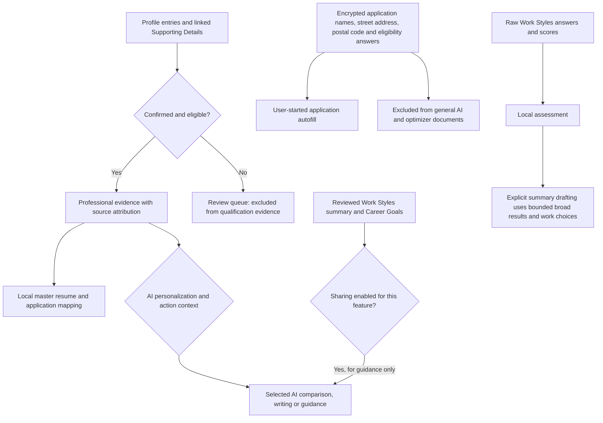

# Career Companion Local

A personal career workspace that runs at **http://localhost:3000** on the computer where you install it. Build a master resume, organize supporting details, compare job postings, prepare applications, and explore private work styles.

Applications can also use your own uploaded resume or be saved without a resume. Attach interview prep, email copies, and other documents to an entry. Application details now use Overview, Documents, and Activity tabs; see [Application details](docs/APPLICATION-DETAILS.md) and [Application documents](docs/APPLICATION-DOCUMENTS.md).
Each installation starts empty. Accounts, documents, saved API keys, and encrypted private disclosures belong to that installation. Each account supplies its own OpenAI API key in Settings. Manual features work without one.

**Latest release** · [App 1.0.14](https://github.com/nikolasleeb/career-companion-local/releases/tag/v1.0.14) · **Extension 1.0.9**

Version 1.0.14 widens Home on large screens, aligns the Explore careers button with its search field, and gives job card actions a consistent size. See the [release notes](docs/RELEASE-NOTES.md) for details.

Interview Practice is separate from Skills. Practice behavioral answers, build STAR responses, or generate original coding problems with AI code review (code is not executed). Sessions can use a saved job/application, company and role, plus up to four private interview-preparation PDFs. Questions, guidance and feedback are manual AI actions using the account’s own key; previous practice remains saved and is included in account backups.

## Profile and AI data use

Eligibility for context does not mean every saved item is sent. Each AI action selects a bounded context; review status, sharing choices and the feature determine what can be used. Routine application autofill makes no AI request.



See the [data-use and permission table](docs/PROFILE-AI-DATA-USE.md) for exact limits, exceptions and the source-code checks behind this chart. These are the implemented boundaries, not a claim that every feature uses every eligible source.

## Run from source

Install a current Docker Desktop, or Docker Engine 28+ with Compose. Clone this repository and open a terminal in its project folder:

```sh
git clone https://github.com/nikolasleeb/career-companion-local.git
cd career-companion-local
docker compose up --build -d
```

Open **http://localhost:3000** and create a local account. If port 3000 is busy, copy `.env.example` to `.env`, change `PORT`, and open that localhost port instead.

Stop with `docker compose stop`; resume with `docker compose up -d`. Keep the `account_data` and `private_vault_key` volumes. **Do not use `down -v`** unless you intend to erase the installation.

## Run a published image

Open [Releases](https://github.com/nikolasleeb/career-companion-local/releases/latest) and download `compose.localhost.yaml` plus the image archive for your CPU:

| Machine architecture | Archive suffix |
| --- | --- |
| Intel/AMD x64 | `linux-amd64.tar.gz` |
| ARM64 | `linux-arm64.tar.gz` |

Verify the archive against `SHA256SUMS`, then follow [LOCALHOST-QUICKSTART.md](LOCALHOST-QUICKSTART.md). Public release downloads require no GitHub token. Building from source does not require access to the Career Companion image registry. Docker may still need internet access to download base images and dependencies.

## Job search without API keys

Public Greenhouse, Ashby and Lever employer feeds and GitHub community listings work without API keys. Complete reviewed education in Profile, choose roles and a location, then search. OpenAI is needed only for optional AI features. USAJOBS and O*NET use optional installation configuration. Adzuna connections belong to individual accounts in Settings → Job Search. Job Search runs on demand. No hosted credentials, accounts or cached results are included.

## Check for updates

Settings → **App & storage** → **App version & updates** shows the installed version, latest complete stable release, and last successful check. Opening Settings checks once per day; **Check now** refreshes manually, subject to a short cooldown. A check sends no account data or API keys and never installs an update.

Published images contain their release version and revision. Locally built source images show **Custom build** unless built by the release workflow. Missing connectivity, incomplete releases, and stale results are shown explicitly.

To update a source installation, save your work, back up both Docker volumes, then:

```sh
git pull --ff-only
docker compose up --build -d
```

For a downloaded image, use the new release's Compose file and archive in the same project folder, preserving both volumes. See the quickstart for details. Updates briefly restart the local app; unsaved browser work should be saved first.

## Localhost boundaries and privacy

- The supplied Compose files publish only `127.0.0.1`. The native launcher binds loopback; the app accepts only local Host headers and rejects forwarding headers. There is no remote deployment configuration.
- The browser extension pairs only with the Career Companion address you explicitly approve. Download it from Application Assistant or build it with `python3 extensions/build.py`.
- The app uses no bundled account, API key, documents, private disclosures, or operator credentials. Git history begins with this clean local edition.
- Optional AI actions send the relevant professional context to OpenAI only when requested. Source integrations contact their respective services. Update checks contact GitHub. This is a local application, not an offline application.
- Private citizenship and disclosure information remains separate from professional documents and AI prompts. Explicit saved Yes/No work-authorization and sponsorship settings can fill matching unqualified questions when you start or resume filling; other private disclosures require review. Browser filling stops before final submission and hands off login, signatures, CAPTCHA, and file uploads.
- Public source can be modified by its installer. The localhost restrictions describe the supplied code and configuration; they cannot prevent someone from changing their own copy.

## Development and validation

The release workflow builds and tests x64 and ARM64 images, exercises a fresh account without a provider key, and publishes downloadable image archives only after both architectures pass. It embeds version metadata and keeps releases immutable.

```sh
python3 scripts/audit_public.py
python3 extensions/build.py
```

Frontend: install the locked dependencies in `frontend` using pnpm, then run `pnpm run build` and `node --test tests/*.test.mjs`. Backend: install `backend/requirements.lock`, then run `python -m pytest backend/tests`. Tests use disposable data and fictional accounts. Browser acceptance checks need their separately installed test browser dependencies.

## Work remaining

- Test installation and upgrades on more clean x64/ARM64 systems, including volume backup and recovery.
- Expand PDF job-posting tests for complex columns, printing artifacts, and scanned PDFs. If text extraction fails, paste the posting text or upload a text-based PDF.
- Expand employer-form fixtures for dynamic fields, inaccessible widgets, and multi-page flows. Unsupported controls must continue to pause for manual completion.
- Validate Safari installation and permissions on additional supported macOS versions.
- Continue accessibility checks with assistive technology and narrow screens.
- Review model pricing and capability catalogs as providers change; estimates are not bills.
- Add release notes and update/recovery regression checks for every future release.

Country names include Unicode CLDR data; see [data/UNICODE-LICENSE.txt](data/UNICODE-LICENSE.txt). Work Styles uses the published IPIP questionnaire and keeps its private results separate from applicant evidence.

### Source builds and update checks

Use `python3 scripts/build_local.py` to build with a source revision stamp, then
start the app with the normal Compose instructions. The helper only builds; it
does not install an update or restart the running app. Uncommitted changes are
stamped `-dirty` and cannot be claimed current. Builds made without a stamp show
an unknown revision. Published images continue to include their release revision.

Settings checks published releases and public `main` source ancestry separately.
A newer commit can exist without a new release. Unknown or diverged builds are
reported explicitly. Checks only read this public repository; they send no
account data, cookies or credentials. Pushing to GitHub does not deploy the
separately operated hosted server.

## Explore careers

Resources → **Explore careers** offers occupation search, education links, skills, national pay/outlook comparisons and an account-owned shortlist. Browsing needs no AI key and works before Profile setup. See the [Explore careers guide](docs/CAREER-EXPLORER.md) for data sources, limitations and saving behavior.

## Overall career direction

Profile → Career Goals separates one optional overall statement from specific milestones. Use guided fields, skip education, or edit your statement directly. Empty fields or `[blank]` omit a part. Goals remain aspirations and automatic AI guidance stays opt-in. See [Career Goals](docs/CAREER-GOALS.md).

## Career fit & direction

Resources → **Career fit & direction · AI** uses the OpenAI Python Agents SDK to explore directions, compare a reviewed shortlist, and assess preparation using sourced evidence. Ask follow-up questions or create a new assessment version when information changes. Proposed next steps connect to Action Plans, Skills, Interview Practice and Career Goals. Public research is optional and off by default; each explicit AI action uses your own key and an adjustable estimated spending ceiling. See [Career Readiness](docs/CAREER-READINESS.md) for evidence boundaries, costs and recovery.

## Profile and master resume

Manage classes on each education card, add them manually or from a locally parsed transcript, and keep Supporting Details with their individual skill or project. Project timelines appear only when a project spans multiple education or job entries. PDF and Word master exports share a snapshot and preserve the full reviewed content with nested coursework and project formatting. See [Profile](docs/PROFILE.md) and [Classes and website materials](docs/PROFILE-EDITOR-MATERIALS.md).
